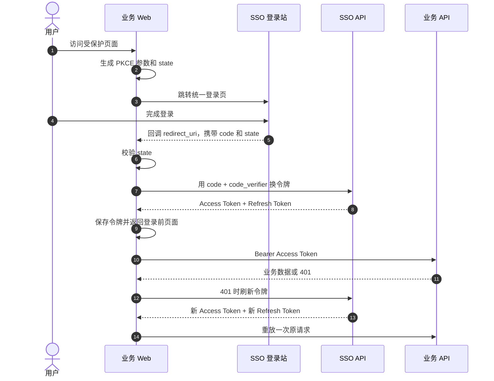

# Web 端 SSO 接入方案

接入过程中遇到问题或者skill使用遇到问题可以留言或者联系@刘润邦

## 1\. 背景介绍

公司已经建设统一的 SSO 登录站。该登录站已接入设备风控、风险命中后的验证码挑战、用户协议与隐私政策、国家/地区信息等合规能力，并使用新的登录、注册接口。

各业务系统不再自行实现账号密码登录，也不需要重复建设上述风控与合规流程，而是把用户引导到 SSO 完成身份认证，再使用 SSO 签发的令牌访问业务接口。

业务方需要申请自己的 OAuth Client，在 Web 端完成登录跳转、回调处理和令牌续期；业务后端仍负责判断用户是否有权访问本系统及具体数据。

**合规化改造要求账号补齐 ****`region`****，因此所有账号都必须重新走一次 SSO 登录流程。以前已经自行接入登录的存量应用，接入 SSO 时必须先执行一次旧 Token 清理，再强制跳转 SSO；具体处理见 5\.2。后续新增的 Web 应用，因为没有旧登录态，不需要执行该迁移。**

## 2\. 接入原理

本方案使用 **OAuth 2\.0 Authorization Code \+ PKCE**，适合无法安全保存 `client_secret` 的 Web 前端。

接入时会用到以下信息：

|名称|作用|
|---|---|
|client\_id|SSO 分配给业务系统的标识|
|redirect\_uri|登录完成后返回业务系统的地址，必须提前登记|
|code|SSO 回调时返回的一次性授权码，用来换令牌|
|Access Token|调用业务接口时携带的访问令牌|
|Refresh Token|Access Token 失效后用来换取新令牌|
|PKCE|通过 `code_verifier` 和 `code_challenge` 保护授权码交换|
|state|关联登录请求与回调，防止 CSRF，并保存登录前页面|

各方职责如下：

|参与方|职责|
|---|---|
|SSO 平台|登录用户、签发授权码和令牌、维护 OAuth Client 和回调白名单|
|业务 Web|发起登录、处理回调、保存令牌、携带令牌请求接口、处理 401|
|业务后端|校验 Access Token，并校验组织、角色和数据权限|

## 3\. 整体接入流程



完整流程分为七步：

1. 用户进入受保护页面，Web 发现没有 Access Token。

2. Web 生成 PKCE 参数和随机 `state`，暂存本次登录上下文。

3. 浏览器跳转到 SSO 登录页。

4. SSO 登录成功后，携带 `code` 和 `state` 回到业务系统的 `redirect_uri`。

5. Web 校验 `state`，再使用 `code` 和本地保存的 `code_verifier` 换取令牌。

6. Web 保存令牌，返回用户登录前访问的站内页面。

7. 业务接口返回 401 时，Web 尝试刷新令牌；刷新失败则清除登录态并重新登录。

接口参数、返回结构和错误码以 [SSO 接口文档](https://booster.feishu.cn/wiki/ISvZw0tX8in4Q8kgx7hcpqZhn8g) 为准。

## 4\. 接入前配置

进入 [SSO 配置平台](https://api-dev.booster.tech/admin/oauth/oauthclient/)（测试环境，线上环境等上线前配置），为业务系统创建 OAuth Client，并配置允许回跳的 `redirect_uri` 白名单。配置时，可以先打开列表中已经接入的 Web 站点如`hichat`作为参考


需要配置：

- Client id：填写业务系统约定的唯一 `client_id`。

- Name：填写便于识别的业务系统名称。

- Redirect uris：填写业务系统实际使用的合法回调地址，例如 `http://localhost:5173/sso/callback` 或 `https://example.booster.tech/sso/callback`。

## 5\. Web 端代码改动

### 5\.1 配置前端环境变量

机构管理后台当前使用的配置如下，业务方可以直接按环境参考。

开发环境 `.env.development`：

```Plaintext
# 如果要默认跳转机构账号登录注册的话就是https://sso-dev.booster.tech/login/organization
VITE_SSO_BASE_URL=https://sso-dev.booster.tech
VITE_SSO_API_BASE_URL=https://api-dev.booster.tech
VITE_SSO_CLIENT_ID=orgin-admin
VITE_SSO_REDIRECT_URI=
```

生产环境 `.env.production`：

```Plaintext
# 如果要默认跳转机构账号登录注册的话就是https://sso.booster.tech/login/organization
VITE_SSO_BASE_URL=https://sso.booster.tech
VITE_SSO_API_BASE_URL=https://api.booster.tech
VITE_SSO_CLIENT_ID=orgin-admin
VITE_SSO_REDIRECT_URI=
```

其他业务接入时，把 `orgin-admin` 换成配置平台为本业务登记的 Client ID。`VITE_SSO_REDIRECT_URI` 留空时，机构后台代码会自动使用“当前站点 origin \+ `/sso/callback`”；如果业务使用其他回调路径，则填写完整地址。无论采用哪种方式，浏览器最终使用的回调地址都必须已登记在 Redirect uris 白名单中。

### 5\.2 存量应用一次性清理旧 Token

只适用于以前已经自行实现登录、用户浏览器中可能保留旧 Token 的存量应用。必须在应用启动和旧登录态判断之前执行：

```TypeScript
const OLD_TOKEN_MIGRATION_KEY = 'has_cleared_old_token'

if (localStorage.getItem(OLD_TOKEN_MIGRATION_KEY) !== '1') {
  // 按本业务原来的存储 key 删除旧 Access Token、Refresh Token 等认证数据
  localStorage.removeItem('old_access_token')
  localStorage.removeItem('old_refresh_token')

  localStorage.setItem(OLD_TOKEN_MIGRATION_KEY, '1')
  const { pathname, search, hash } = window.location
  await startSsoLogin(`${pathname}${search}${hash}`)
  return
}
```

### 5\.3 发起登录

每次登录需要：

1. 生成随机 `code_verifier`，计算 `code_challenge = base64url(SHA-256(code_verifier))`。

2. 生成随机 nonce。

3. 把 `code_verifier` 和 nonce 放入 `sessionStorage`，仅供本次登录回调使用。

4. 把 nonce 和登录前的站内路径 `returnTo` 编入 `state`。

5. 跳转到 `${SSO_BASE_URL}/login`。

登录 URL 携带：

```Plaintext
client_id=<client_id>
redirect_uri=<redirect_uri>
response_type=code
code_challenge=<code_challenge>
code_challenge_method=S256
state=<state>
next=/oauth/authorize
lang=cn|en
```

登录跳转必须去重，如果重复生成登录上下文，后一次会覆盖前一次，回调时就会出现 `state mismatch`。

### 5\.4 增加鉴权守卫和公开回调路由

- 所有需要登录的业务路由统一放在鉴权守卫下。

- 没有 Access Token 时发起 SSO 登录，跳转期间只显示加载状态。

- `/sso/callback` 必须是公开路由，不能套鉴权守卫。

- 回调路由必须放在通配路由之前，避免 `code` 被路由重定向吞掉。

### 5\.5 处理登录回调

回调页面读取 `code`、`state`、`error` 和 `error_description`，然后：

1. 清理地址栏中的回调参数，避免授权码留在浏览器历史中。

2. 从 `sessionStorage` 读取并删除登录上下文。

3. 比较回调 `state` 中的 nonce 与本地 nonce；不一致时立即终止。

4. 使用 `code` 和 `code_verifier` 请求令牌。

5. 保存 Access Token 和 Refresh Token。

6. 返回登录前页面；没有合法页面时回到首页。

React 开发环境的 Strict Mode 可能让 Effect 执行两次，而授权码只能使用一次。业务方要保证换令牌只执行一次。

### 5\.6 换取并保存令牌

机构后台向 `${SSO_API_BASE_URL}/oauth/token` 发送：

```JSON
{
  "grant_type": "authorization_code",
  "client_id": "<client_id>",
  "code": "<code>",
  "code_verifier": "<code_verifier>",
  "redirect_uri": "<redirect_uri>"
}
```

机构后台当前把 Access Token 和 Refresh Token 存在 `localStorage`

### 5\.7 业务请求和令牌刷新

每次业务请求发送前读取最新 Access Token，并设置：

```HTTP
Authorization: Bearer <access_token>
```

业务接口返回 401 时：

1. 有 Refresh Token 才请求 `${SSO_API_BASE_URL}/api/v1/auth/token/refresh`。

2. 请求体为 `{ "refresh": "<refresh_token>" }`。

3. 保存响应中的新 Access Token 和新 Refresh Token。

4. 使用新 Access Token 重放原请求一次。

5. 刷新失败或重放后仍为 401，则清除本地令牌并重新登录。

多个接口同时返回 401 时，只允许发起一个刷新请求，其他请求等待同一个刷新结果。服务端会轮换 Refresh Token，因此必须同时保存新的 Access Token 和 Refresh Token。

### 5\.8 退出登录

退出时至少清除本地 Access Token、Refresh Token 和未完成的登录上下文。

## 6\. 联调步骤

按以下顺序联调，出现问题时可以快速判断属于配置、SSO、Web 还是业务后端：

1. **检查配置**：确认 `client_id`、登录站地址、API 地址和回调地址属于同一环境。

2. **检查登录跳转**：清空本地令牌，访问受保护页面，确认进入 SSO 登录页，URL 中包含 PKCE 和 `state` 参数。

3. **检查回调**：完成登录，确认回到 `/sso/callback`，`state` 校验通过，地址栏中的 `code` 被清理。

4. **检查换令牌**：确认 `/oauth/token` 返回 Access Token；Network 截图或日志中必须遮挡令牌内容。

5. **检查业务请求**：确认业务接口带 Bearer Token，后端能识别当前用户。

7. **检查刷新**：让业务接口返回 401，确认只刷新一次，随后原请求成功重放。

8. **检查失效处理**：让 Refresh Token 失效，确认清理本地令牌并重新登录，没有无限请求。

9. **检查退出**：确认本地登录态已清除

## 7\.Skill提供

\[SKILL\.md\]

根据机构后台的接入经验，沉淀了一版Skill，可以配合下面的提示词使用

```Markdown
请使用 web-sso-integration Skill，直接为当前 Web 项目完成 Booster 公司统一 SSO 接入。

接入信息：
- SSO Client ID：[必填]
- SSO 回调路由：[必填，例如 /sso/callback；必须以 / 开头，不能使用 /oauth、/api 等接口前缀]
- 应用类型：[新应用 / 存量应用 / 不确定]
```

如果提示词没有提供 Client ID 或回调路由未填写，skill不会修改代码或环境变量，会直接提供 SSO 配置平台地址，需要自己先创建或补全公开客户端
